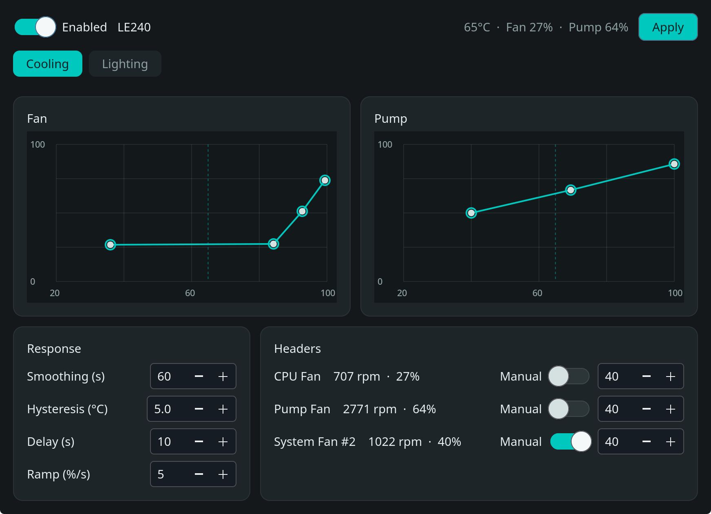
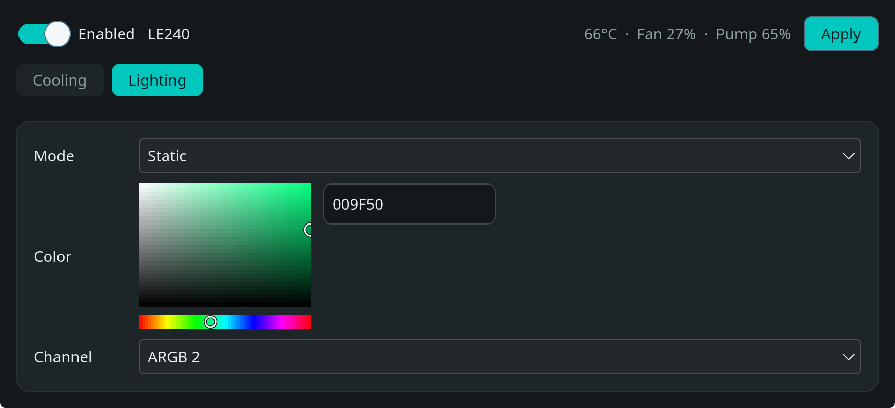

# LE240 V2 controller for SteamOS

Fan, pump, and lighting control for the DeepCool LE240 V2.

The pump and radiator fans are motherboard PWM headers. The LEDs are on a motherboard addressable-RGB header. This driver sets both from a settings window and from `le240.service`.

Not affiliated with DeepCool. PWM uses [nct6687d](https://github.com/Fred78290/nct6687d) (GPL-2.0), cloned and built for the running kernel by the installer. See `driver/README.md`.





## Requirements

Python 3 and GTK 4. Both ship with SteamOS.

## Install

From this directory:

```bash
sudo ./bin/install-system.sh
```

This installs:

- the `nct6687` sensor module for the running kernel
- `le240.service`, enabled at boot
- the **LE240** application menu entry
- `~/.local/bin/le240-control`

## Use

Open **LE240** from the application menu, or run:

```bash
le240-control
```

Cooling edits the fan curve and the pump curve. Drag a point to move it, click the graph to add one, right-click a point to remove it. Each connected header can be set to a manual duty. The readout above Apply is the CPU temperature and the duty each curve calls for at that temperature.

Lighting sets the mode, color, speed, and channel. The color field updates the LEDs while it is changed.

**Enabled** off returns the fan headers to the firmware curve. Apply writes `config/cooler.json`. The service reloads that file.

## Remove

Stops the service and deletes the unit, the module blacklist, the menu entry, and the `le240-control` launcher. The project directory stays.

```bash
sudo ./bin/uninstall-system.sh
```

## Preview

Print the headers without writing PWM:

```bash
PYTHONPATH=. python3 -m le240 --preview
```

## Tests

```bash
PYTHONPATH=. python3 -m unittest discover tests
```

## Documentation

- [Cooling](docs/control.md)
- [Lighting](docs/lighting.md)
- [Hardware](docs/hardware.md)

## License

This project is MIT. The sensor module it builds at install time, [nct6687d](https://github.com/Fred78290/nct6687d), is GPL-2.0-or-later and stays under that license.
